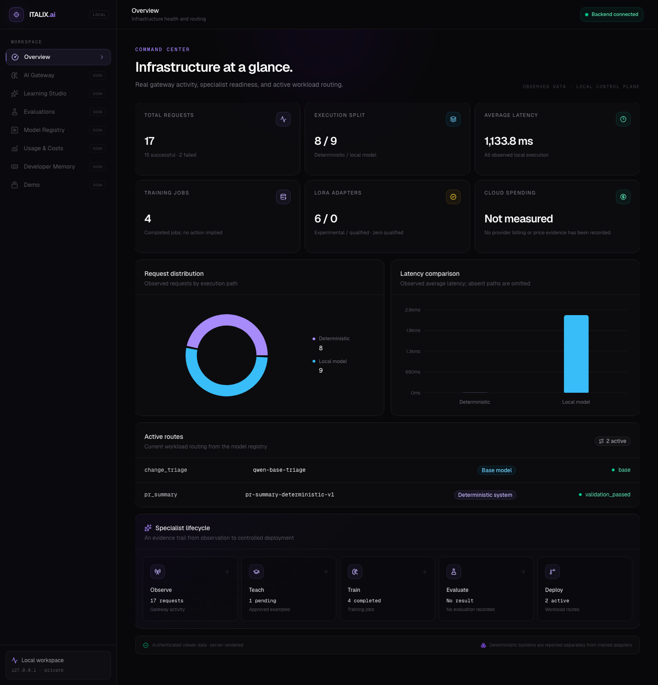
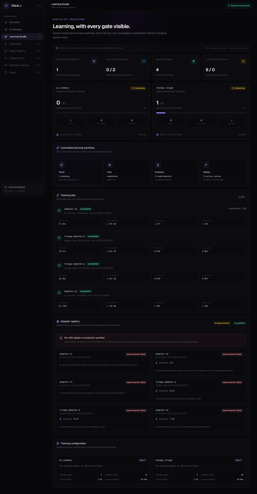
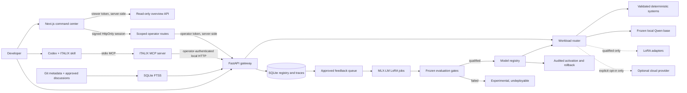

<div align="center">

# ITALIX.ai

### Your AI Learns. Your Costs Shrink.

**A local-first AI gateway for engineering workflows, controlled model learning, and source-backed Developer Memory.**

Original project by [Saad Bin Ather](https://github.com/saadbinather).

[](https://www.python.org/)
[](https://fastapi.tiangolo.com/)
[](https://github.com/ml-explore/mlx-lm)
[](frontend/)
[](#verification)
[](#security-and-privacy)

[Two pillars](#two-pillars-one-local-first-platform) · [Capabilities](#working-capabilities) · [Architecture](#architecture) · [Quickstart](#local-quickstart) · [Codex](#codex-mcp-integration) · [Evidence](#current-evidence)

</div>

---

## Two pillars, one local-first platform

Engineering teams repeatedly pay general-purpose models to solve familiar
tasks, while the reasoning behind important code decisions becomes scattered
across commits and conversations. ITALIX.ai addresses both problems without
turning developer data into an uncontrolled training stream.

### 1. AI Cost Optimization

ITALIX.ai creates a controlled path from developer feedback to smaller local
specialists for recurring tasks such as PR summaries and change triage:

```text
Observe → Review → Teach → Train → Evaluate → Deploy
```

- **Learn from approved feedback.** Capture is off by default. Developers can
  explicitly approve or correct eligible interactions before they enter a
  workload-specific training queue.
- **Fine-tune locally.** MLX-LM performs real rank-bounded LoRA updates against
  a frozen local base model, with training evidence recorded for review.
- **Route by demonstrated quality.** Frozen evaluations, qualification gates,
  a persistent model registry, and audited activation keep experimental
  adapters away from production routes.
- **Roll back safely.** Route changes and rollback events use the same registry
  and audit path, so a workload can return to its previous safe model.

The practical goal is straightforward: handle repeated developer workloads
with smaller local specialists when they can match the required quality, and
reserve expensive cloud inference for cases that genuinely need it. **That
goal has not yet been proven as measured savings.** Cloud spending is currently
reported as “not measured,” and no LoRA adapter is production-qualified today.

### 2. Developer Memory

Developer Memory turns selected engineering history into a searchable,
source-backed knowledge layer:

- Search imported Git commit metadata and explicitly approved team discussion
  exports.
- Recover why a decision was made instead of relying only on the current code.
- Retrieve labeled evidence before asking the local model to compose an answer.
- Return the supporting sources with the answer.
- Abstain when relevant evidence is missing rather than inventing context.

This helps developers investigate regressions, revisit tradeoffs, and onboard
into unfamiliar code with a traceable path back to the original evidence.
Memory data remains isolated from feedback and LoRA training queues. The
backend capability is implemented, but **Developer Memory does not yet have a
dedicated Next.js page**.

### What ITALIX.ai controls

Both pillars run through the same authenticated local gateway, audit trail,
and explicit-consent boundaries. The system keeps three different assets
honestly separated:

| Asset | Meaning | Deployment rule |
|---|---|---|
| **Base model** | Frozen local Qwen foundation | May remain the safe default |
| **LoRA adapter** | Trained experimental specialist | Must pass every server-owned qualification gate |
| **Deterministic system** | Code-based, evidence-only specialist | Validated independently; never labeled as a trained adapter |

ITALIX.ai favors evidence over automatic promotion: prompts are not retained
by default, training never implies deployment, lower loss does not imply
qualification, and unsupported memory questions should produce an abstention.

## Working capabilities

- **Authenticated local gateway** with chat-completions-style responses,
  workload routing, latency, trace IDs, validation metadata, and safe
  abstention.
- **Deterministic PR summarization** that extracts changed files, identifiers,
  constants, supported renames, and fallback values directly from Git diffs.
- **Opt-in hybrid change triage** in the Gateway UI, FastAPI, and Codex MCP.
  Path policy determines the classification. A local model can select
  supporting excerpts on request. Unsupported, ambiguous, or conflicting
  changes are sent for human review.
- **Model-free startup** for health checks, deterministic PR summaries,
  policy-only hybrid triage, and model-independent tests.
- **Consent-based traces and feedback** with approve, correct, and reject
  states.
- **Training queue isolation**: captured data is not automatically eligible,
  and feedback never starts training. Queue deduplication and reviewed,
  checksummed dataset snapshots protect training from repeated examples and
  changes after review.
- **Real MLX-LM LoRA jobs** from a frozen cached base, including loss, duration,
  memory, parameter-delta, and adapter-update evidence.
- **Evaluation and qualification gates** that reject unsupported claims,
  malformed output, repetition, factual contradictions, missing identifiers,
  and incorrect fallbacks.
- **Persistent model registry** with active routes, adapter status, deployment
  history, audit events, and rollback.
- **Developer Memory** over selected Git commit metadata and explicitly
  approved discussion exports, isolated from LoRA training data.
- **Codex MCP integration** for status, inference, feedback, learning progress,
  controlled training plans, and controlled deployment plans.
- **Next.js command center** with Overview, AI Gateway, and read-only
  Learning Studio pages.

## Product command center

The UI reads real gateway data through server-side authenticated clients. It
does not place FastAPI bearer tokens in browser JavaScript.

### Overview



### Learning Studio



The screenshots above are from the running local system. Values represent that
original local demo database at capture time.

## Architecture



## Tech stack

| Layer | Technology |
|---|---|
| Local inference and training | Apple MLX, MLX-LM, pinned Qwen 4-bit model catalog |
| Gateway | Python 3.11, FastAPI, Uvicorn, Pydantic, HTTPX |
| Persistence | SQLite, SQLite FTS5 |
| Command center | Next.js 16.4.5 App Router, React 19, TypeScript, Tailwind CSS 4, Recharts |
| Agent integration | Model Context Protocol over stdio, project-local Codex Skill |
| Quality | Pytest, Playwright, TypeScript, ESLint |

## Repository map

```text
italix.ai/
├── italix/                 # Gateway, routing, registry, training, memory, MCP
├── frontend/               # Authenticated Next.js command center
├── tests/                  # Backend and MCP regression tests
├── scripts/                # Dataset, evaluation, training, and audit utilities
├── training/               # Versioned MLX-LM experiment configurations
├── data/                   # Synthetic, team-authored publishable fixtures
├── docs/                   # Technical implementation evidence
└── .codex/skills/italix/   # Project-local Codex workflow policy
```

Model weights, adapters, checkpoints, traces, SQLite files, secrets, logs,
private datasets, sealed holdouts, and temporary experiments are intentionally
excluded from Git.

## Local quickstart

### Requirements

- Apple Silicon Mac with a supported macOS release
- Python 3.11
- Node.js 20 or newer and npm
- Git
- For optional local generation, allow disk space for the model snapshot and
  memory for inference alongside macOS and other applications

### 1. Clone and install the backend

```bash
git clone https://github.com/saadbinather/italix.ai.git
cd italix.ai

python3.11 -m venv .venv
source .venv/bin/activate
python -m pip install --upgrade pip
python -m pip install -r requirements.txt
```

The backend starts without model weights. Install models explicitly for local
generation. The supported Apple Silicon models use MLX 4-bit snapshots.

| Model | Catalog ID | Pinned revision | Full snapshot |
| --- | --- | --- | ---: |
| Qwen2.5-1.5B-Instruct | `qwen-base` | `8b403126fc14f14cfc99bb4cfa72ecbc129ea677` | 0.82 GiB |
| Qwen3-4B-Instruct-2507 | `qwen3-4b` | `50d427756c6b1b2fe0c0a10f67fbda1fc8e82c1b` | 2.12 GiB |
| Qwen2.5-Coder-7B-Instruct | `qwen-coder-7b` | `019cc73c45c770444708a6dd8690c66243cc5c80` | 4.00 GiB |

Cache the default Qwen base using this explicit download command. Change
`model_id` to download one of the optional revisions.

```bash
python - <<'PYMODEL'
from huggingface_hub import snapshot_download
from italix.engines import LOCAL_MODELS

model_id = "qwen-base"
model = LOCAL_MODELS[model_id]
snapshot_download(model.repository, revision=model.revision)
PYMODEL
```

Use the default Hugging Face cache location for the ordinary gateway and
training paths. Set `ITALIX_HYBRID_MODEL=qwen3-4b` or `qwen-coder-7b` before
starting FastAPI to opt into a different model for hybrid explanations.
The MLX worker lazily loads the selected model and evicts the resident model
when switching. Existing chat and adapter routes use the 1.5B base. A missing
snapshot leaves deterministic routes usable.

For an offline inference smoke test after caching the base:

```bash
HF_HUB_OFFLINE=1 python -m scripts.compare_local_models qwen-base /tmp/italix-smoke.jsonl --smoke
```

The smoke output path must be new. The optional comparison protocol is
documented in [Phase 8](docs/PHASE8_MODEL_COMPARISON.md) and
[Phase 9](docs/PHASE9_COMPARISON.md).

### 2. Configure local secrets

```bash
cp .env.example .env
chmod 600 .env
```

Fill these with distinct high-entropy values of at least 32 characters:

```dotenv
ITALIX_VIEWER_TOKEN=
ITALIX_OPERATOR_TOKEN=
ITALIX_OPERATOR_UNLOCK_SECRET=
ITALIX_SESSION_SECRET=
```

Cloud keys are optional. Leave them empty for a fully local workflow. A cloud
route still requires `allow_cloud=true` on that individual request.

### 3. Start FastAPI

```bash
source .venv/bin/activate
HF_HUB_OFFLINE=1 TRANSFORMERS_OFFLINE=1 python -m italix.main
```

FastAPI binds to `http://127.0.0.1:8000`; `/health` remains public while every
`/v1` endpoint requires a viewer or operator bearer token. Use
`ITALIX_DB_PATH="$(mktemp -d)/italix.sqlite"` to isolate a test launch.
Verify model-free startup with `curl -fsS http://127.0.0.1:8000/health`.

### 4. Start the command center

```bash
cd frontend
npm ci
npm run dev
```

Open `http://127.0.0.1:3000`. The frontend binds only to localhost, loads the
root `.env` server-side, and never exposes backend tokens through a public
browser bundle.

To copy the local operator unlock secret without printing it:

```bash
cd frontend
npm run operator:copy-secret
```

## FastAPI gateway usage

Load the local environment, then call the protected gateway:

```bash
set -a
source .env
set +a

curl --silent --show-error \
  --request POST http://127.0.0.1:8000/v1/chat/completions \
  --header "Authorization: Bearer ${ITALIX_OPERATOR_TOKEN}" \
  --header 'Content-Type: application/json' \
  --data '{
    "model": "pr-summary-deterministic-v1",
    "workload": "pr_summary",
    "messages": [{
      "role": "user",
      "content": "Summarize this diff:\n\ndiff --git a/config.py b/config.py\n--- a/config.py\n+++ b/config.py\n@@ -1 +1 @@\n-TIMEOUT = 30\n+TIMEOUT = 10"
    }],
    "temperature": 0,
    "max_tokens": 320,
    "capture": false,
    "allow_cloud": false
  }'
```

The response includes the generated content plus ITALIX metadata such as the
selected registry model, route, trace ID, validation, capture status, and any
abstention reason. This example works without MLX weights.

In the Gateway UI, select **Hybrid change triage** and paste a unified Git
diff. Enable local evidence selection only when needed. The equivalent
operator API is `POST /v1/hybrid/change-triage/v2` with `content` and optional
`explain`. It returns policy evidence, validation status, human-review reason
when applicable, and timing and token counts when available.

## Codex MCP integration

The local MCP server reuses the authenticated FastAPI backend. From the
repository root:

```bash
codex mcp add italix -- "$(pwd)/.venv/bin/python" -m italix.mcp_server
codex mcp list
```

Codex shares MCP configuration between its CLI and IDE integration; the
official setup pattern uses `codex mcp add` followed by `codex mcp list` for
verification ([official Codex MCP documentation](https://developers.openai.com/learn/docs-mcp)).

Start Codex from the repository so the MCP process can load the ignored root
`.env`. The project-local skill in `.codex/skills/italix/SKILL.md` adds consent
and diff-redaction rules for these registered tools:

- `italix_status`
- `italix_learning_status`
- `italix_chat`
- `italix_hybrid_triage`
- `italix_submit_feedback`
- `italix_train_specialist`
- `italix_deploy_specialist`

Inference never authorizes cloud access. Capture, feedback, training execution,
and activation each remain separately controlled.

## Real LoRA fine-tuning and learning pipeline

ITALIX.ai performs genuine local adapter updates rather than simulating a
training job:

```text
captured trace
  → explicit developer approval or correction
  → workload-specific pending queue
  → minimum-example readiness and dataset snapshot checks
  → explicit local training execution
  → frozen-base MLX-LM LoRA update
  → tensor-delta verification
  → frozen evaluation
  → qualified or experimental_failed
```

Recorded job evidence includes optimizer steps, loss history, elapsed time,
peak MLX memory, trainable parameter counts, changed tensors, changed scalar
elements, maximum adapter delta, evaluation results, and the registered
candidate version.

Training does **not** activate an adapter. Evaluation does **not** weaken the
deployment gate. Failed candidates remain undeployable even if activation is
requested directly.

## Evaluation, registry, routing, and rollback

Evaluation is workload-specific and server-owned:

- **PR summaries:** four required sections, exact identifier retention,
  supported fallback values, no invented renames, no unsupported behavior or
  testing claims, bounded repetition, and factual consistency.
- **Change triage:** exact schema and policy values for owner, risk, and
  reviewer.
- **Qualification:** a candidate must satisfy the complete gate. Lower training
  loss or partial improvement is not enough.

The registry stores base models, adapters, and deterministic systems as
different kinds. Activation writes an audit event; rollback restores the
workload’s base route through the same registry path.

## Current evidence

Historical evaluations used small synthetic datasets and workload-specific gates.

| Workload / candidate | Evidence | Status |
|---|---:|---|
| `pr-summary-deterministic-v1` | 16/16 development cases and 8/8 additional audit scenarios | `validation_passed`, active deterministic system |
| PR-summary production scaffold | 6/16 on the independent v4 development set | Baseline only |
| `adapter-v4` | 7/16 on the same set | `experimental_failed` |
| `adapter-v3` | 4/6 versus scaffold 5/6 | `experimental_failed` |
| Change-triage compact base prompt | 0/12 exact validation | Baseline only |
| Change-triage full policy scaffold | 6/12 exact validation | Baseline only |
| `triage-adapter-b` | 9/12 exact validation | `experimental_failed` |
| Phase 5 change triage LoRA | 5/12 exact, 12/12 owner and reviewer, 5/12 risk | `experimental_failed` |
| Experiment A, replacement corpus | 6/12 exact | `experimental_failed` |
| Experiment C, balanced corpus | 4/12 exact | `experimental_failed` |
| Experiment E, risk-token weighting | 4/12 exact | `experimental_failed` |
| Experiment F, classification-aware objective | 0/12 exact | `experimental_failed` |

No tested LoRA adapter passed qualification. Change-triage validation shares
templates with training. The auxiliary diagnostic split informed experiment
design, and the reserved final evaluation was kept sealed. Lower loss and
workload qualification results cannot establish generalization.

Phase 9 ran matched zero-shot smoke tests on an M1 Pro with 16 GB unified
memory. Each model ran nine requests across three cases.

| Model | Warm median latency | Mean decode throughput | Peak MLX |
| --- | ---: | ---: | ---: |
| Qwen2.5 1.5B | 438 ms | 147 tokens/s | 1.39 GB |
| Qwen3 4B | 1,154 ms | 66 tokens/s | 2.86 GB |
| Qwen2.5-Coder 7B | 1,482 ms | 43 tokens/s | 4.78 GB |

The larger models summarized the two-file smoke case more accurately.
All three guessed classifications on cases that required abstention.
The 100-case pilot is synthetic and still needs independent human review.
Long-context performance, workload-wide model ranking, and cost savings are
unverified. Developer Memory currently has a backend API and Learning Studio
is read-only.


## Developer Memory

Developer Memory provides evidence retrieval without feeding records into
fine-tuning:

- Imports explicitly selected Git commit metadata.
- Imports only explicitly approved discussion JSON/JSONL files.
- Redacts configured sensitive patterns before persistence.
- Indexes records in SQLite FTS5.
- Retrieves labeled sources before local answer generation.
- Abstains when retrieval has no relevant evidence.
- Keeps memory records isolated from the feedback and training queues.

See [`docs/STEP8_DEVELOPER_MEMORY.md`](docs/STEP8_DEVELOPER_MEMORY.md) for the
supported formats and safety boundary.

## Security and privacy

- Public `/health`; role-protected `/v1` endpoints.
- Distinct viewer and operator bearer tokens with constant-time comparison.
- Server-only FastAPI tokens in Next.js; no `NEXT_PUBLIC_` credentials.
- Short-lived HMAC-signed operator sessions using Secure, HttpOnly,
  SameSite=Strict cookies.
- Same-origin checks, JSON content-type enforcement, request-size limits, and
  strict parameter allowlists on the browser inference path.
- `capture=false` and `allow_cloud=false` by default.
- Captured prompt/response payloads require explicit consent. Credential-like
  content is screened on capture, feedback, and hybrid triage. Pattern-based
  screening can miss sensitive content. Sanitize patches before sending.
- Training feedback requires an eligible captured trace.
- Read-only Learning Studio responses expose aggregate metrics, never raw
  examples, prompts, responses, adapter paths, or log paths.
- Local services bind to `127.0.0.1` by default.
- Secrets, SQLite state, traces, weights, checkpoints, logs, and sealed datasets
  are excluded from version control.

The Phase 9 production npm audit reported zero findings. The full npm audit
still reported development-tooling advisories. A publication audit of the pinned
Python requirements reported advisories in `python-dotenv`, `mcp`, `streamlit`,
and the development test runner `pytest`. The quickstart is for local loopback
use. Review and update affected dependencies before exposing the services.

## Verification

Backend and integration tests:

```bash
source .venv/bin/activate
pytest
```

Frontend checks:

```bash
cd frontend
npm ci
npm run typecheck
npm run lint
npm run build
npm run test:security
```

Browser checks require the local FastAPI and production Next.js processes:

```bash
npm run test:operator-persistent
npm run test:gateway-browser
npm run test:learning-browser
```

## Attribution and licensing

This GitHub fork preserves the original project history and attribution to
[Saad Bin Ather](https://github.com/saadbinather). The
[upstream repository](https://github.com/saadbinather/italix.ai) has no
repository-wide license file. Third-party dependencies and separately
downloaded model snapshots are governed by their respective licenses. The
Qwen MLX snapshot listings identify Apache-2.0.

---

<div align="center">

**ITALIX.ai — Your AI Learns. Your Costs Shrink.**

Built for controlled local learning, measurable evidence, and safe promotion.

</div>
