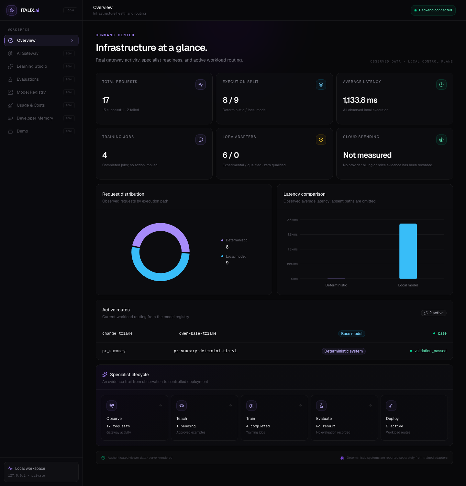
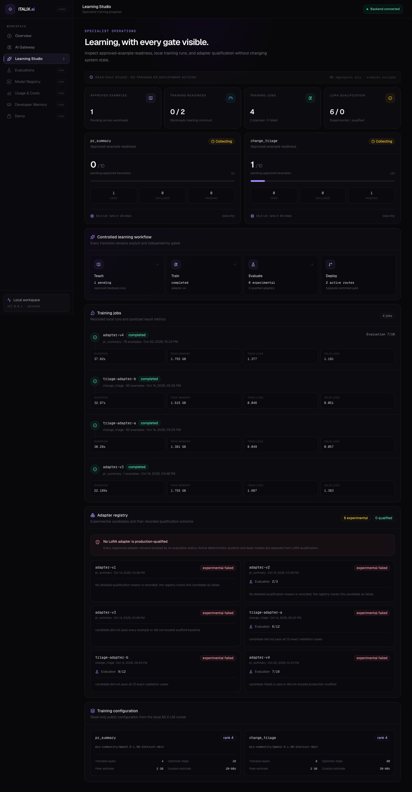
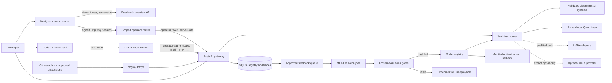

<div align="center">

# ITALIX.ai

### Your AI Learns. Your Costs Shrink.

**A local-first AI optimization control plane for observing developer workflows, collecting approved feedback, training bounded specialists, proving quality, and routing only qualified systems.**

[](https://www.python.org/)
[](https://fastapi.tiangolo.com/)
[](https://github.com/ml-explore/mlx-lm)
[](frontend/)
[](#verification)
[](#security-and-privacy)

[Why ITALIX](#why-italixai) · [Capabilities](#working-capabilities) · [Architecture](#architecture) · [Quickstart](#local-quickstart) · [Codex](#codex-mcp-integration) · [Evidence](#current-evidence)

</div>

---

## Why ITALIX.ai

General-purpose models can help with software work, but production teams still
need answers to harder operational questions:

- What actually ran, where did it route, and how long did it take?
- Which developer corrections are approved for learning?
- Did a specialist improve on fixed evaluation inputs—or merely lower its loss?
- Can an experimental adapter be prevented from reaching production?
- Can useful local work stay local by default?
- Are savings measured, or only projected from assumptions?

ITALIX.ai turns those questions into one controlled loop:

```text
Observe → Review → Teach → Train → Evaluate → Deploy
```

The product combines a local gateway, explicit feedback capture, genuine
Apple-Silicon LoRA training, server-owned evaluation gates, a persistent model
registry, auditable routing and rollback, developer memory, Codex MCP tools,
and an authenticated command center.

> **Cost claim discipline:** the tagline expresses the product goal. This
> repository does not claim measured savings. Current cloud spending is
> reported as “not measured,” and any future savings projection must remain
> separate from observed usage.

## The solution

ITALIX.ai is designed around evidence rather than automatic promotion:

1. **Route locally first.** Workloads resolve through an explicit registry.
2. **Capture only with consent.** Prompts and responses are not retained by
   default.
3. **Teach from reviewed feedback.** Approve, correct, or reject a captured
   interaction; only approved records can enter a training queue.
4. **Train deliberately.** Local MLX-LM jobs require sufficient examples and
   an explicit execution request.
5. **Prove quality.** Frozen inputs and workload-specific gates decide whether
   a candidate qualifies.
6. **Deploy safely.** Failed candidates stay undeployable; activation and
   rollback are recorded separately from training.

This creates an honest separation between three very different assets:

| Asset | Meaning | Deployment rule |
|---|---|---|
| **Base model** | Frozen local Qwen foundation | May remain the safe default |
| **LoRA adapter** | Trained experimental specialist | Must pass every server-owned qualification gate |
| **Deterministic system** | Code-based, evidence-only specialist | Validated independently; never labeled as a trained adapter |

## Working capabilities

- **Authenticated local gateway** with chat-completions-style responses,
  workload routing, latency, trace IDs, validation metadata, and safe
  abstention.
- **Deterministic PR summarization** that extracts changed files, identifiers,
  constants, supported renames, and fallback values directly from Git diffs.
- **Change triage** against a fixed policy schema with explicit validation.
- **Consent-based traces and feedback** with approve, correct, and reject
  states.
- **Training queue isolation**: captured data is not automatically eligible,
  and feedback never starts training.
- **Real MLX-LM LoRA jobs** from a frozen cached base, including loss, duration,
  memory, parameter-delta, and adapter-update evidence.
- **Evaluation and qualification gates** that reject unsupported claims,
  malformed output, repetition, factual contradictions, missing identifiers,
  and incorrect fallbacks.
- **Persistent model registry** with active routes, adapter status, deployment
  history, audit events, and rollback.
- **Developer Memory** over selected Git commit metadata and explicitly
  approved discussion exports, isolated from LoRA training data.
- **Codex MCP integration** for status, inference, feedback, learning progress,
  controlled training plans, and controlled deployment plans.
- **Premium Next.js command center** with Overview, AI Gateway, and read-only
  Learning Studio pages.

## Product command center

The UI reads real gateway data through server-side authenticated clients. It
does not place FastAPI bearer tokens in browser JavaScript.

### Overview



### Learning Studio



The screenshots above are from the running local system. Values represent that
local database at capture time—not synthetic time series or guaranteed future
results.

## Architecture



## Tech stack

| Layer | Technology |
|---|---|
| Local inference and training | Apple MLX, MLX-LM, Qwen2.5 1.5B Instruct 4-bit |
| Gateway | Python 3.11, FastAPI, Uvicorn, Pydantic, HTTPX |
| Persistence | SQLite, SQLite FTS5 |
| Command center | Next.js 16 App Router, React 19, TypeScript, Tailwind CSS 4, Recharts |
| Agent integration | Model Context Protocol over stdio, project-local Codex Skill |
| Quality | Pytest, Playwright, TypeScript, ESLint |

## Repository map

```text
italix.ai/
├── italix/                 # Gateway, routing, registry, training, memory, MCP
├── frontend/               # Authenticated Next.js command center
├── tests/                  # Backend and MCP regression tests
├── scripts/                # Dataset, evaluation, training, and audit utilities
├── training/               # Versioned MLX-LM experiment configurations
├── data/                   # Synthetic, team-authored publishable fixtures
├── docs/                   # Technical implementation evidence
└── .codex/skills/italix/   # Project-local Codex workflow policy
```

Model weights, adapters, checkpoints, traces, SQLite files, secrets, logs,
private datasets, sealed holdouts, and temporary experiments are intentionally
excluded from Git.

## Local quickstart

### Requirements

- Apple Silicon Mac with a supported macOS release
- Python 3.11
- Node.js 20 or newer and npm
- Git
- Approximately 2 GB of available unified memory for the documented small
  LoRA runs, in addition to application and model overhead

### 1. Clone and install the backend

```bash
git clone https://github.com/saadbinather/italix.ai.git
cd italix.ai

python3.11 -m venv .venv
source .venv/bin/activate
python -m pip install --upgrade pip
python -m pip install -r requirements.txt
```

The gateway expects the frozen Qwen base in the local Hugging Face cache and
does not silently download a model during a request. Run the explicit smoke
workflow once if the model is not already cached:

```bash
python scripts/check_environment.py
python scripts/smoke_inference.py
```

That first model setup may require network access. Normal local routing and
training use the cached base.

### 2. Configure local secrets

```bash
cp .env.example .env
chmod 600 .env
```

Fill these with distinct high-entropy values of at least 32 characters:

```dotenv
ITALIX_VIEWER_TOKEN=
ITALIX_OPERATOR_TOKEN=
ITALIX_OPERATOR_UNLOCK_SECRET=
ITALIX_SESSION_SECRET=
```

Cloud keys are optional. Leave them empty for a fully local workflow. A cloud
route still requires `allow_cloud=true` on that individual request.

### 3. Start FastAPI

```bash
source .venv/bin/activate
python -m italix.main
```

FastAPI binds to `http://127.0.0.1:8000`; `/health` remains public while every
`/v1` endpoint requires a viewer or operator bearer token.

### 4. Start the command center

```bash
cd frontend
npm ci
npm run dev
```

Open `http://127.0.0.1:3000`. The frontend binds only to localhost, loads the
root `.env` server-side, and never exposes backend tokens through a public
browser bundle.

To copy the local operator unlock secret without printing it:

```bash
cd frontend
npm run operator:copy-secret
```

## FastAPI gateway usage

Load the local environment, then call the protected gateway:

```bash
set -a
source .env
set +a

curl --silent --show-error \
  --request POST http://127.0.0.1:8000/v1/chat/completions \
  --header "Authorization: Bearer ${ITALIX_OPERATOR_TOKEN}" \
  --header 'Content-Type: application/json' \
  --data '{
    "model": "italix-auto",
    "workload": "pr_summary",
    "messages": [{
      "role": "user",
      "content": "Summarize this diff:\n\ndiff --git a/config.py b/config.py\n--- a/config.py\n+++ b/config.py\n@@ -1 +1 @@\n-TIMEOUT = 30\n+TIMEOUT = 10"
    }],
    "temperature": 0,
    "max_tokens": 320,
    "capture": false,
    "allow_cloud": false
  }'
```

The response includes the generated content plus ITALIX metadata such as the
selected registry model, route, trace ID, validation, capture status, and any
abstention reason.

## Codex MCP integration

The local MCP server reuses the authenticated FastAPI backend. From the
repository root:

```bash
codex mcp add italix -- "$(pwd)/.venv/bin/python" "$(pwd)/italix/mcp_server.py"
codex mcp list
```

Codex shares MCP configuration between its CLI and IDE integration; the
official setup pattern uses `codex mcp add` followed by `codex mcp list` for
verification ([official Codex MCP documentation](https://developers.openai.com/learn/docs-mcp)).

Start Codex from the repository so the MCP process can load the ignored root
`.env`. The project-local skill in `.codex/skills/italix/SKILL.md` adds consent
and diff-redaction rules for these registered tools:

- `italix_status`
- `italix_learning_status`
- `italix_chat`
- `italix_submit_feedback`
- `italix_train_specialist`
- `italix_deploy_specialist`

Inference never authorizes cloud access. Capture, feedback, training execution,
and activation each remain separately controlled.

## Real LoRA fine-tuning and learning pipeline

ITALIX.ai performs genuine local adapter updates rather than simulating a
training job:

```text
captured trace
  → explicit developer approval or correction
  → workload-specific pending queue
  → minimum-example readiness check
  → explicit local training execution
  → frozen-base MLX-LM LoRA update
  → tensor-delta verification
  → frozen evaluation
  → qualified or experimental_failed
```

Recorded job evidence includes optimizer steps, loss history, elapsed time,
peak MLX memory, trainable parameter counts, changed tensors, changed scalar
elements, maximum adapter delta, evaluation results, and the registered
candidate version.

Training does **not** activate an adapter. Evaluation does **not** weaken the
deployment gate. Failed candidates remain undeployable even if activation is
requested directly.

## Evaluation, registry, routing, and rollback

Evaluation is workload-specific and server-owned:

- **PR summaries:** four required sections, exact identifier retention,
  supported fallback values, no invented renames, no unsupported behavior or
  testing claims, bounded repetition, and factual consistency.
- **Change triage:** exact schema and policy values for owner, risk, and
  reviewer.
- **Qualification:** a candidate must satisfy the complete gate. Lower training
  loss or partial improvement is not enough.

The registry stores base models, adapters, and deterministic systems as
different kinds. Activation writes an audit event; rollback restores the
workload’s base route through the same registry path.

## Current evidence

These are actual repository results, not projected benchmarks:

| Workload / candidate | Evidence | Status |
|---|---:|---|
| `pr-summary-deterministic-v1` | 16/16 development cases and 8/8 additional audit scenarios | `validation_passed`, active deterministic system |
| PR-summary production scaffold | 6/16 on the independent v4 development set | Baseline only |
| `adapter-v4` | 7/16 on the same set | `experimental_failed` |
| `adapter-v3` | 4/6 versus scaffold 5/6 | `experimental_failed` |
| Change-triage compact base prompt | 0/12 exact validation | Baseline only |
| Change-triage full policy scaffold | 6/12 exact validation | Baseline only |
| `triage-adapter-b` | 9/12 exact validation | `experimental_failed` |

No LoRA adapter is currently production-qualified. PR summarization is served
by a separately validated deterministic system; change triage remains on its
base route. Sealed holdouts were not opened for failed candidates.

## Developer Memory

Developer Memory provides evidence retrieval without feeding records into
fine-tuning:

- Imports explicitly selected Git commit metadata.
- Imports only explicitly approved discussion JSON/JSONL files.
- Redacts configured sensitive patterns before persistence.
- Indexes records in SQLite FTS5.
- Retrieves labeled sources before local answer generation.
- Abstains when retrieval has no relevant evidence.
- Keeps memory records isolated from the feedback and training queues.

See [`docs/STEP8_DEVELOPER_MEMORY.md`](docs/STEP8_DEVELOPER_MEMORY.md) for the
supported formats and safety boundary.

## Security and privacy

- Public `/health`; role-protected `/v1` endpoints.
- Distinct viewer and operator bearer tokens with constant-time comparison.
- Server-only FastAPI tokens in Next.js; no `NEXT_PUBLIC_` credentials.
- Short-lived HMAC-signed operator sessions using Secure, HttpOnly,
  SameSite=Strict cookies.
- Same-origin checks, JSON content-type enforcement, request-size limits, and
  strict parameter allowlists on the browser inference path.
- `capture=false` and `allow_cloud=false` by default.
- Captured prompt/response payloads require explicit consent.
- Training feedback requires an eligible captured trace.
- Read-only Learning Studio responses expose aggregate metrics, never raw
  examples, prompts, responses, adapter paths, or log paths.
- Local services bind to `127.0.0.1` by default.
- Secrets, SQLite state, traces, weights, checkpoints, logs, and sealed datasets
  are excluded from version control.

## Verification

Backend and integration tests:

```bash
source .venv/bin/activate
pytest
```

Frontend checks:

```bash
cd frontend
npm ci
npm run typecheck
npm run lint
npm run build
npm run test:security
```

Browser checks require the local FastAPI and production Next.js processes:

```bash
npm run test:operator-persistent
npm run test:gateway-browser
npm run test:learning-browser
```

---

<div align="center">

**ITALIX.ai — Your AI Learns. Your Costs Shrink.**

Built for controlled local learning, measurable evidence, and safe promotion.

</div>
